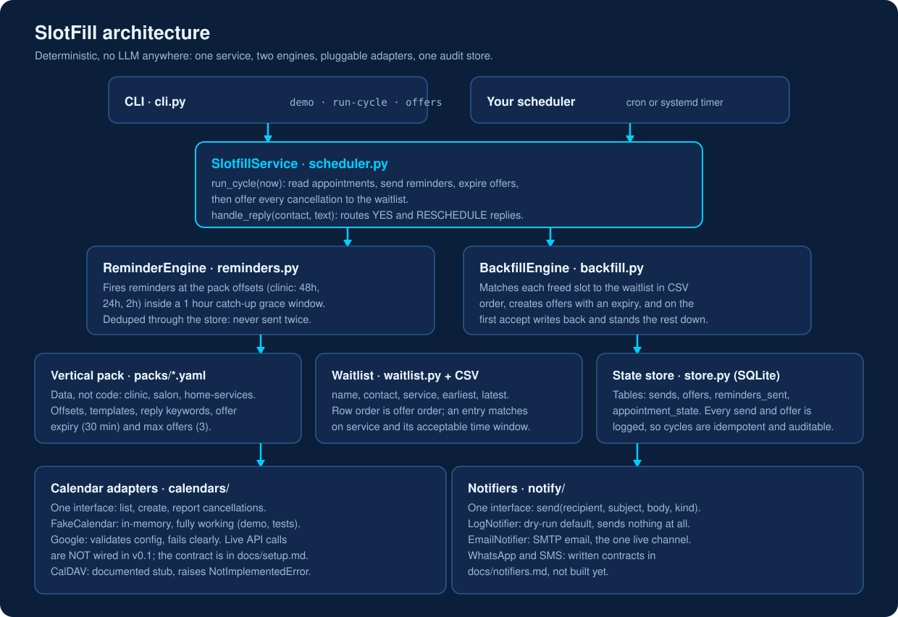
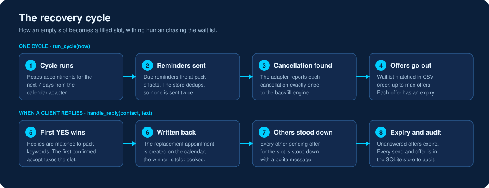
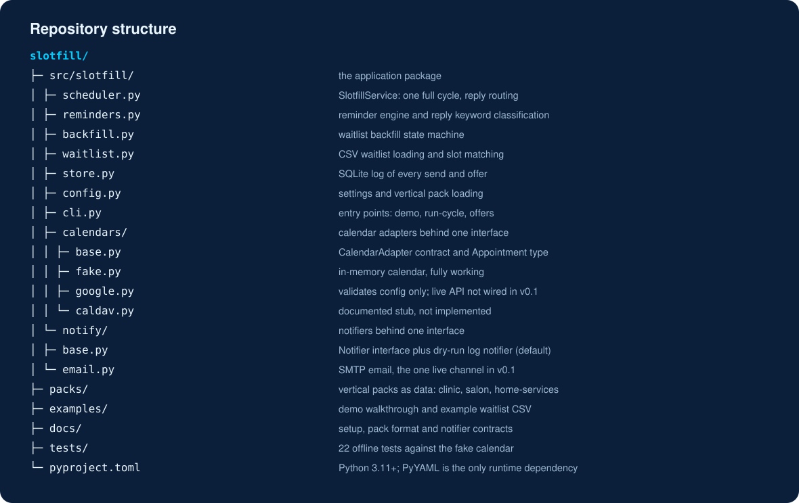

<h1 align="center">SlotFill</h1>

<p align="center"><strong>TechAurah open source</strong></p>

**SlotFill is a no-show recovery service that sends appointment reminders and backfills cancelled slots from your waitlist, on the calendar you already use.**


[](https://www.linkedin.com/company/techaurah/)

**Proof it works:** 22 automated tests and a fully deterministic engine, with no LLM anywhere in it, MIT licensed.

<p align="center">
  
</p>

[Docs](docs/setup.md) · [Examples](examples/demo.md) · [Vertical packs](docs/packs.md) · [Notifiers](docs/notifiers.md) · [TechAurah](https://techaurah.com) · [For AI assistants: llms.txt](llms.txt)

## What is SlotFill?

SlotFill is a deterministic no-show recovery service for appointment businesses such as clinics, salons and home services. It sends reminder sequences from a vertical pack, watches for cancellations, and offers each freed slot to the waitlist in order until someone confirms. It is not a booking system, and there is no LLM anywhere in it.


<p align="center">
  
</p>

## Why do appointments end up empty?

Appointment businesses lose a slot twice when a client no-shows or cancels late: the hour sits empty, and the waitlisted client who would happily have taken it is never asked. Clinic no-show rates run at 12 to 42% across settings (systematic review, Mazaheri Habibi et al., 2024), and MGMA DataDive 2025 found 19.95% of appointments were cancelled in 2024 while only 27.4% of those were rescheduled within 30 days. The empty slot is mostly a cancellation problem, which is why reminders alone are not the fix.

The market's answers are to rip out your booking system for a platform, or to pay per-staff SaaS. SlotFill does neither.

**SlotFill does** reminders, waitlist backfill and a full audit log on top of your existing calendar. **It does not** take bookings, replace your booking system, or talk to your clients with an AI. There is no LLM anywhere in v0.1: every behaviour is deterministic, testable state-machine logic.

## Demo

<p align="center">
  
</p>

`slotfill demo` runs the whole flow offline on a fake calendar. Nothing is sent. Abridged output:

```
Step 1: Tom Reed cancels tomorrow's 10:00 checkup (A-101).
Step 2: Run one SlotFill cycle (reminders + backfill offers).
  Cycle summary: {'reminders_sent': 2, 'offers_expired': 0, 'cancellations': 1, 'offers_created': 3}
Step 3: Ben Cole (2nd on the waitlist) replies YES first.
  Reply action: backfill_accepted:fake-1
Step 5: Offer ledger in the state store:
  offer #1  Ana Ruiz    slot 2026-11-03T10:00:00  status: stood_down
  offer #2  Ben Cole    slot 2026-11-03T10:00:00  status: accepted
  offer #3  Cara Diaz   slot 2026-11-03T10:00:00  status: stood_down
```

Full annotated walkthrough: [examples/demo.md](examples/demo.md).

## Quickstart (5 minutes, zero accounts)

```bash
git clone https://github.com/techaurah/slotfill.git
cd slotfill
python -m pip install -e .
slotfill demo
python -m pytest   # the whole suite, offline
```

Prerequisites: Python 3.11 or newer. That is all. The demo and tests use the bundled fake calendar, the example waitlist and the dry-run notifier, so a stranger can see SlotFill work before configuring anything. Real setup (SMTP, Google Calendar status, scheduling cycles) is in [docs/setup.md](docs/setup.md).

**Ways to run it:**

- **Demo:** `slotfill demo` runs the whole flow offline on the bundled fake calendar; nothing is sent.
- **One cycle:** `slotfill run-cycle` runs a single cycle on the seed data, or call `SlotfillService.run_cycle(now)` from your own code.
- **Scheduled cycles:** run cycles on a schedule (cron or a systemd timer) with the default dry-run notifier until you configure a real one (see [docs/setup.md](docs/setup.md)).

## What does SlotFill do?

- [x] **Reminder sequences per vertical** driven by data packs: offsets, templates and reply keywords for [clinic](packs/clinic.yaml), [salon](packs/salon.yaml) and [home services](packs/home-services.yaml)
- [x] **Confirm and reschedule reply handling** by keyword, with acknowledgements
- [x] **Waitlist in a plain CSV** any business can export or type, matched in order by service and acceptable time window ([format](docs/packs.md))
- [x] **Backfill state machine**: cancellation, offer with expiry, first confirmed accept wins, write-back to the calendar, everyone else stood down politely
- [x] **Calendar adapters behind one interface**: a fully working fake calendar, a Google Calendar adapter that validates configuration and fails clearly when unconfigured, and a CalDAV stub with a written contract ([status, honestly](docs/setup.md))
- [x] **Pluggable notifiers**: SMTP email, plus a dry-run log notifier as the default so a fresh install sends nothing ([contracts](docs/notifiers.md))
- [x] **SQLite state store** logging every send and every offer: no reminder is ever sent twice, and every backfill decision can be audited
- [x] **Idempotent cycles**: run it on any schedule; re-running a cycle at the same time is a no-op

## How is SlotFill different from a booking platform?

|  | SlotFill | Booking platform (for example Fresha, Square Appointments) | Chasing the waitlist by phone |
|---|---|---|---|
| Migration | None: it sits on the calendar and booking setup you already have | Replace your booking system and move clients onto the platform | None |
| Cost | Free and open source (MIT), self-hosted | Per-staff or per-location subscription; marketplace platforms can also take a commission on bookings they source | Staff time, every time it happens |
| Lock-in | Your calendar, your CSV waitlist, your SQLite log | Bookings and client data live inside the vendor platform | Knowledge lives in a notebook or someone's memory |
| Scope | One job, completely: reminders and waitlist backfill | A broad suite (booking, payments, marketing) where backfill is one feature among many | Whatever someone remembers to do on a busy day |
| How backfill happens | Automatic, in waitlist order, first confirmation wins, everything logged | Reminders are bundled; waitlist backfill varies and is often still manual | Phone calls when someone notices the gap, first to pick up wins |

## Which calendars does SlotFill work with?

In v0.1 the fully working calendar is the bundled fake calendar, which runs the demo and the whole test suite offline. The Google Calendar adapter validates your configuration and fails clearly when credentials are missing, and its live API wiring contract is written in [docs/setup.md](docs/setup.md) as the next build step. CalDAV is a documented adapter contract in the code, not yet implemented. Nothing is silently faked.

## Configuration

The settings people actually touch (full reference in [docs/setup.md](docs/setup.md) and `.env.example`):

| Setting | Env variable | Default |
|---|---|---|
| Vertical pack | `SLOTFILL_PACK` | `packs/clinic.yaml` |
| Waitlist CSV | `SLOTFILL_WAITLIST` | `examples/waitlist.csv` |
| State store | `SLOTFILL_DB` | `slotfill.db` |
| Business name in messages | `SLOTFILL_BUSINESS_NAME` | `Your Business` |
| Email sending | `SLOTFILL_SMTP_HOST` and friends | unset, so dry-run |
| Google Calendar credentials | `SLOTFILL_GOOGLE_CREDENTIALS` | unset |

## Examples

| Example | What it shows | Time | Credentials |
|---|---|---|---|
| `slotfill demo` ([walkthrough](examples/demo.md)) | Full cycle: reminders, cancellation, offers, accept, write-back, stand-downs | 1 minute | None |
| [Example waitlist](examples/waitlist.csv) | The CSV format, including a non-matching entry that is correctly never offered a slot | 1 minute | None |
| Test suite (`tests/`) | Every state machine transition, executable | 2 minutes | None |

## Roadmap

- **Now:** v0.1, this release. Fake calendar demo, email notifier, three vertical packs.
- **Next:** live Google Calendar API wiring (contract written in [docs/setup.md](docs/setup.md)); CalDAV adapter implementation.
- **Later:** WhatsApp and SMS notifier adapters, each with its own compliance review before it can send (see [docs/notifiers.md](docs/notifiers.md)); Sheet-backed waitlist as an alternative to CSV. A full conversational booking agent is a recorded possible evolution, not a promise.

## Frequently asked questions

### What does SlotFill cost?

Nothing. SlotFill is free and open source under the MIT license, and you host it yourself. There are no per-staff fees, no per-booking charges and no commission on filled slots. Your only costs are the machine it runs on and your own email sending, which for most small businesses is effectively zero.

### Do I need to replace my booking system?

No, and that is the point. Keep your booking page, your practice system or your paper diary workflow exactly as it is. SlotFill only needs read and write access to the calendar behind it, plus your waitlist as a CSV file. Bookings, payments and client records stay in the system you already use.

### Which calendars does SlotFill work with?

Honestly, in stages. The bundled fake calendar works completely and runs the demo and the whole test suite. The Google Calendar adapter validates your configuration and fails clearly until credentials are set; its live API wiring is written as a contract in the docs and is the next build step. CalDAV is a documented contract, not yet implemented.

### Does SlotFill message my clients automatically, and through what?

Yes, once you configure it and schedule its cycles. Reminders and backfill offers go out as email through your own SMTP server, using the templates in your vertical pack. A fresh install sends nothing: the default notifier only logs. WhatsApp and SMS are written notifier contracts in the docs, not built yet, and every sent message is recorded.

### What does SlotFill not do?

SlotFill is deliberately narrow. It does not take bookings, provide a booking page, process payments, hold your client records or replace your CRM. It does not talk to clients with an AI: there is no LLM anywhere in v0.1, only templates you control. It sends reminders, backfills cancelled slots from your waitlist, and logs everything it does.

### How do I add a pack for my industry?

A pack is one YAML data file, so no code is needed. Copy the clinic, salon or home-services pack, then set your reminder offsets, message templates and the reply keywords that mean confirm or reschedule in your business. Point SLOTFILL_PACK at your file and run the demo cycle. The format is documented in docs/packs.md, and pack pull requests are welcome.

### Can I use SlotFill for my clients?

Yes. The MIT license allows commercial use, including deploying SlotFill for paying clients, with no licence fee and no per-client charge. Agencies typically run one instance per client, with that client's own calendar, waitlist and business name in the settings. If you would rather have it run for you, TechAurah, the company behind SlotFill, takes on that work commercially.

### How do I get help or report a problem?

Use GitHub Issues for bugs and concrete feature requests, and Discussions for questions and ideas; both are linked from the community table below. Report anything security related privately through SECURITY.md, never as a public issue. For commercial support or implementation help, contact TechAurah through techaurah.com and mention SlotFill so it reaches the right people.

Questions and ideas: use [GitHub Discussions](https://github.com/techaurah/slotfill/discussions).

## Repository structure

<p align="center">
  
</p>

Plain text version: [docs/assets/directory-tree.txt](docs/assets/directory-tree.txt).

## Contributing

Read [CONTRIBUTING.md](CONTRIBUTING.md), find a `good first issue`, and open a PR that links its issue and passes CI. The easiest first contribution is a vertical pack: one YAML data file, no code. Calendar adapters and template packs are also well-bounded. Response rhythm and PR rules are in CONTRIBUTING.

## Community and support

| Channel | Best for |
|---|---|
| [Issues](https://github.com/techaurah/slotfill/issues) | Bugs and concrete feature work |
| [Discussions](https://github.com/techaurah/slotfill/discussions) | Questions, ideas, show and tell |
| [SECURITY.md](SECURITY.md) | Vulnerabilities (private, never a public issue) |
| [TechAurah website](https://techaurah.com) | The company behind the project |

## License

MIT. See [LICENSE](LICENSE).

## About TechAurah

TechAurah is an AI and software engineering company building products, agents and automation for service businesses, and publishing the deterministic parts as open source. We are available for AI engineering projects: https://techaurah.com

## More from TechAurah

- [AI Lead Automation](https://github.com/techaurah/ai-lead-automation): the open blueprint for capture, instant reply, AI qualification, CRM write, follow-up and booking in service businesses
- [LeadPipe MCP](https://github.com/techaurah/leadpipe-mcp): an MCP server that gives small businesses without a CRM a scored, bookable lead pipeline on Google Sheets and Calendar
- [n8n-audit](https://github.com/techaurah/n8n-audit): a production-readiness linter for n8n workflows, catching secrets, open webhooks and missing error handling before they drop leads
- [QualBench](https://github.com/techaurah/qualbench): outcome regression testing for AI qualification and booking agents, with mock CRM and calendar
- [ChaseKit](https://github.com/techaurah/chasekit): the open-source invoice-chasing layer for freelancers and small businesses, with UK and EU statutory interest

All six projects are MIT licensed and open to contributions: [github.com/techaurah](https://github.com/techaurah)

Follow TechAurah on [LinkedIn](https://www.linkedin.com/company/techaurah/).
